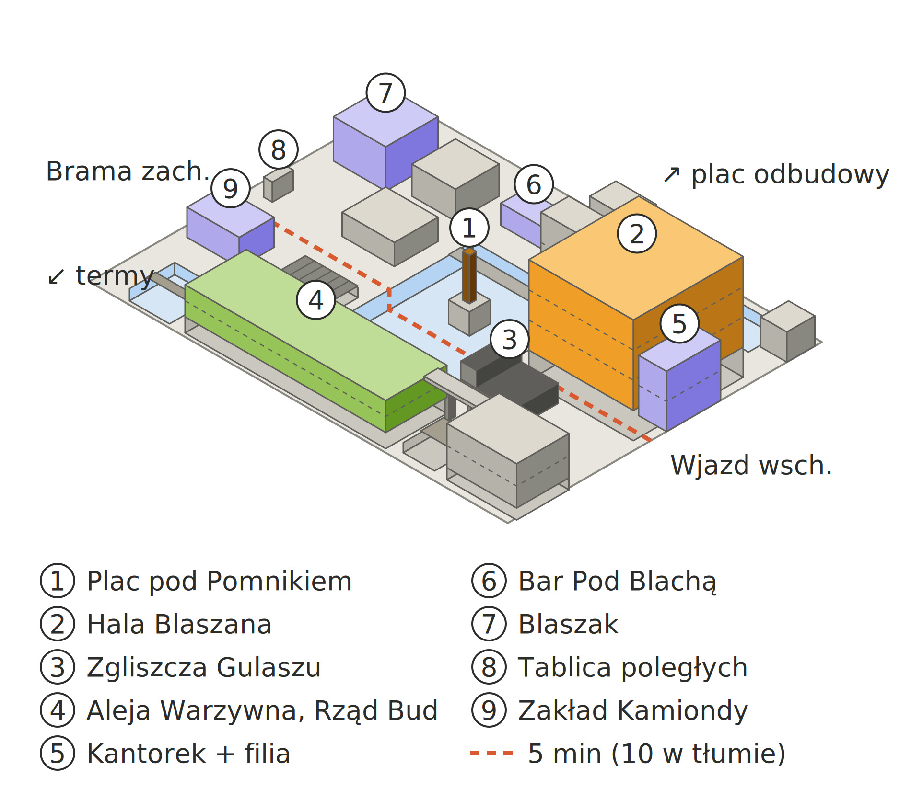

# Spalony Gulasz w Szemrotach — co wiemy po sesjach 1–3

Stan na 16.10.2026, koniec [sesji 3](raporty/sesja-03.md). Szczegóły konfliktów i żetonów są w raportach z poszczególnych sesji.

## W skrócie

Jesteśmy lokalną komórką Terriletei, agencji, która ubezpiecza i odbudowuje tereny po wojnie i zajmuje się anomaliami „niższego sortu”; pieniądze ma od Aurum. Przyjechałyśmy do Szemrot po anonimowym cynku, że pomnik Sowińskiego chodzi nocą do spalonego baru „Gulasz u Mamy”. Po trzech sesjach wiemy, że bar podpalono celowo, żeby zasypać zejście do podziemi, a Ida, córka właścicielki, żyje i próbuje rozebrać mur pod pomnikiem i „Gulaszem”. Według niej za murem jest dowód, że jej matka zamurowała ludzi. Za każdym razem, gdy Ida próbuje się przebić, przychodzi Sowiński, a ubytki wypełnia twardy „brąz”.

Sesja 3 skończyła się przy tym murze: jesteśmy pod ziemią z Idą i przestraszonym dzieciakiem z młodzieży, Irse nie ma sprzętu, a Fafik uciekł w panice przed czymś, czego nikt inny nie usłyszał.

Zegar: Centrala dała nam 3 dni od sesji 2, czyli realnie ok. 2,5 dnia.

## Mapa targowiska

| # | Miejsce | Co się tam wydarzyło |
| --- | --- | --- |
| 1 | Plac pod Pomnikiem | Samosąd na Xavierze (s1). Pomnik Sowińskiego bez dłoni, zabudowany blachą pod pozorem inspekcji; próbki z kikuta (s2). Pod placem jest mur, przy którym skończyłyśmy sesję 3. |
| 2 | Hala Blaszana | Główna hala targowiska na dnie dawnego basenu. |
| 3 | Zgliszcza Gulaszu | Podpalenie udowodnione, druga butla przy drzwiach piwnicy, pod piwnicą zamurowane i częściowo skute zejście (s2). |
| 4 | Aleja Warzywna, Rząd Bud | Stoiska handlarzy; to oni ze składek ufundowali tablicę poległych. |
| 5 | Kantorek + filia | Kantorek Zawirucha i nasza filia: tu nocujemy, tu przesłuchałyśmy Xaviera (s1). |
| 6 | Bar Pod Blachą | — |
| 7 | Blaszak | Stąd pochodzi chłopak z młodzieży, który wyniósł z podziemi metalową puszkę (s3). |
| 8 | Tablica poległych | Nazwiska cywilów, którzy zginęli przy zalaniu Noktian (konflikt zero). |
| 9 | Zakład Kamiondy | — |

Przerywana linia to droga przez targowisko: 5 minut, w tłumie 10. Termy są poza mapą, kilka minut autem w stronę zachodniej bramy, i nie należą do Aurum. Aurum wykupiło tereny na placu odbudowy i bliżej wschodniego wjazdu.

## Co ustaliłyśmy

### Pożar „Gulaszu u Mamy”

- Podpalenie było przygotowane: Wiesława i Ida wyszły z pożaru ubrane i obute, jakby na to czekały (kamery, s1).
- W piwnicy przy drzwiach stała druga butla z gazem, ustawiona tak, żeby wybuch zasypał zejście (s2).
- Pod piwnicą jest zamurowane, częściowo skute zejście niżej (s2).
- Wiesława nie zgłosiła szkody, choć bar był ubezpieczony (s1).

### Ida

- Żyje, ukrywa się w podziemiach. Najpierw pod termami, gdzie miała obozowisko, teraz przy murze pod „Gulaszem” (s1, s3).
- Chce „odkupić grzechy matki”. Twierdzi, że Wiesława zamurowała ludzi, a teraz wydaje zupy, żeby to odkupić. Kłamie też Aurum (s1, s3).
- Jest nienaturalnie spokojna, bez śladów środków w źrenicach. Spokój pęka tylko przy temacie matki (s3).
- Jej dłonie to blizny na bliznach, rany rozrywane i gojone przez lata. Nie pasuje to do kilku dni w podziemiach (s3).
- Na jednej klatce nagrania z pożaru dziwnie się świeci (s1).
- Drony do niej nie strzelały (s3).

### Pomnik Sowińskiego i „brąz”

- Dłoni nie odcięto zwykłym narzędziem: nie ma śladów cięcia ani opiłków. Zostają laser, cięcie wodą albo efekt magiczny (s2).
- Fafik wyczuwa przy pomniku coś świeżego. Drzwi „Gulaszu” łączą się z pomnikiem, a z piwnicy idzie coś innego, osobnego (s2).
- Według Idy Sowiński przychodzi, ilekroć ona próbuje otworzyć mur. Ubytki są potem wypełnione pustymi w środku, niezwykle twardymi „cegłami” z czegoś, co wygląda jak brąz (s3).
- Ten sam „brąz” zalewa przejścia w tunelach i zaczął budować wokół materaca Idy kratę z cienkich, ostrych jak żyletki błon, jak celę (s3).
- Pomnik jest z brązu, nie z marmuru (s3).

### Mur pod pomnikiem i „Gulaszem”

- Cegły i tynk są dużo młodsze niż otoczenie (s3).
- Mur jest naruszony, na cegłach zaschnięta krew i naskórek (s3).
- Fafik coś przy nim usłyszał i pierwszy raz w życiu uciekł w panice. Ani my, ani sprzęt niczego nie zarejestrowałyśmy (s3).

### Aurum i Ksenia Radlic

- Ksenia ma wszczepy zastępujące organy i te wszczepy szwankują: kaszel, „lagi”. Możliwa anomalia albo skażenie magiczne (s2).
- Jej operacja wygląda na samowolkę, a plan odbudowy Szemrot to pięcioletnia wydmuszka (s2).
- W penthousie ma centrum operacyjne: za dużo sprzętu i dronów jak na wizytę szefowej (s2).
- W całej okolicy od lat rośnie temperatura, choć termy ledwo działają. Ksenia narzekała, że temperatura w podłożu jest wyższa, niż mówiły raporty (s2).
- Pod ziemią latają uzbrojone drony. Są automatyczne i w strefie zakłóceń straciły łączność z operatorem, a ich AI uznało nas za zagrożenie. Czyje są, nie wiemy (s3).

### Miasto

- Młodzież, fani streamu Idy, jest przekonana, że dorośli chcą ją zabić. Zbiera się w grupki i skanduje (s2, s3).
- Młodzież dostaje się do podziemi mimo zabezpieczeń Zawirucha (s3).
- Ktoś z młodzieży z Blaszaka wyniósł z podziemi metalową puszkę. Nie umieją jej otworzyć i chcą ukraść narzędzia konserwatorowi pomnika. Tosia i Bartek poszli ją odzyskać (s3).
- Sporo ludzi w mieście tłumi kaszel (s2).

## Ludzie

| Kto | Kim jest | Gdzie stoimy |
| --- | --- | --- |
| Ida | Córka Wiesławy, streamerka | Z nami przy murze; ufa nam na tyle, że nas tam przyprowadziła |
| Wiesława | Właścicielka „Gulaszu”, wydawała posiłki biednym | Jeszcze z nią nie rozmawiałyśmy |
| Xavier | Chłopak Idy, nosił jej jedzenie | W przychodni: przebite płuco, ślad anomalii (s1–s2) |
| Roman Zawiruch | Zarządca targowiska, znajomy Kate | Zabezpiecza wejścia do tuneli za pieniądze firmy; podejrzewa, że ukrywamy coś gorszego |
| sierżant Marek Obuch | Miejscowy posterunek | Zamknął sprawę pożaru (instalacja); zawiózł Xaviera do przychodni |
| Ksenia Radlic | Aurum, nasza osoba kontaktowa | Dała nam dostęp do dokumentacji; wyszła z rozmowy, gdy Leon zapytał o epidemię |
| asystentka Kseni | „Szara mysz”, cicha, ambitna | Do obserwowania |
| Tosia | Z młodzieży | Poszła z Bartkiem odzyskać puszkę |
| Bartek | Ochroniarz term, „jedną nogą” z młodzieży | Z Tosią |
| dzieciak z młodzieży | Ok. 13 lat | Z nami pod ziemią, w ciężkim szoku |
| Centrala | Centrala Terriletei, nasza szefowa | 3 dni na zamknięcie sprawy, kontener medyczny, zgoda na hakowanie korpo |

## Stan drużyny

| Graczka | Postać | Stan na koniec sesji 3 |
| --- | --- | --- |
| Irse | Infiltrator | Przezskórne łącze przypalone: do końca tej sytuacji bez sprzętu, jak na kacu. Leczenie potrwa kilka dni. Ma dysk z drona. |
| Kate | Ratownik (Kiki) | Bez strat. |
| Luna | Medyczka, z psem Fafikiem | Fafik w szoku, pierwszy raz uciekł. |
| Finka | Likwidator Szkód (Leon) | Niesie strąconego drona. |

## Zasoby i co jest w drodze

- Rano zrzut kontenera medycznego, dostosowanego do próbek kraty. Dotrze na pewno (s3).
- Rano sprzęt do eksploracji podziemi (skanery, drony mapujące) i informacje o korpo (s2).
- Pozwolenie na badania przesiewowe mieszkańców od rana (s2).
- Ciche i oficjalne pozwolenie na hakowanie korpo. Jeśli nas wykryją i powiążą, filia zostaje zamknięta (s2).
- Wyniki próbek z pomnika i chusteczki Kseni miały przyjść późnym popołudniem (s2), jeszcze ich nie widziałyśmy.
- Do zbadania na górze: próbki kraty, dron, dysk z drona, a kiedyś szczur z pułapki Kate.

## Otwarte wątki

- [ ] Zdecydować, co z murem: otwierać teraz czy wycofać się i wrócić przygotowanymi.
- [ ] Wyprowadzić Idę i dzieciaka na powierzchnię; zbadać Idę.
- [ ] Ustalić, co usłyszał Fafik i czy to nadchodzący Sowiński.
- [ ] Sprawdzić, czy Tosia i Bartek odzyskali puszkę, zanim młodzież okradnie konserwatora.
- [ ] Porozmawiać z Wiesławą: zamurowani ludzie, druga butla, niezgłoszona szkoda.
- [ ] Odebrać wyniki próbek i kontener, ruszyć z badaniami mieszkańców.
- [ ] Odczytać dysk i zbadać drona; ustalić, kto je uzbroił.
- [ ] Ustalić, jak młodzież obchodzi zabezpieczenia wejść.
- [ ] Przejrzeć dokumentację od Kseni; ostrożnie hakować korpo.
- [ ] Znaleźć gaszących pożar, którzy mogli widzieć, dokąd poszła Ida.
- [ ] Załatwić leczenie łącza Irse.

## Pytania bez odpowiedzi

- Co jest za murem i kto go postawił?
- Czym jest „brąz”: tym samym, z czego jest pomnik? Czy pomnik naprawdę chodzi?
- Kto lub co odcięło dłoń Sowińskiego?
- Skąd Ida ma stare blizny i czemu jest tak spokojna? Czemu świeciła na nagraniu?
- Co siedzi w piwnicy „Gulaszu”, osobno od tego, co łączy drzwi z pomnikiem?
- Czym skaził się Xavier?
- Co jest w metalowej puszce?
- Dlaczego w Szemrotach rośnie temperatura i czego naprawdę szuka tu Ksenia?
- Kto stoi nad Ksenią i czyje są uzbrojone drony?
- Jaką rolę gra lodowaty korytarz z czasów zalania Noktian?
- Co widział pies w tłumie pod pomnikiem w sesji 1?
